<div align="center">

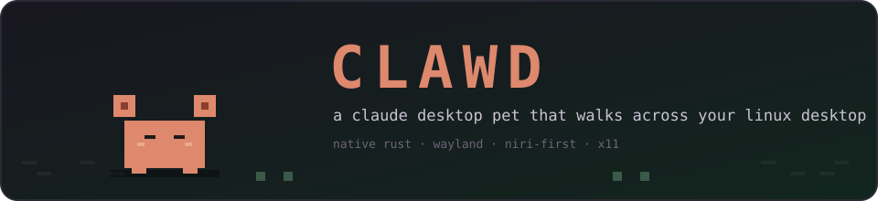


[](https://github.com/devsw-prayas/clawd-walks-on-your-desktop)

</div>

Clawd is a Claude desktop pet that lives on your screen and reacts to what
you're doing. Same puppet, same moods as
[upstream Clawd](https://github.com/devsw-prayas/clawd-walks-on-your-desktop),
rebuilt for Linux as a **single 2.2 MB Rust binary** using ~6.5 MB of RAM.

- 🐾 Floats above every window (Wayland `zwlr_layer_shell_v1` overlay)
- ⌨️ Types along when you're focused in Claude Code, sips coffee on breaks
- 🚶 Goes on random walks when it's ignored long enough
- 👀 Eyes follow your cursor (global on X11, hover-only on Wayland)
- 📋 Reacts to your clipboard, battery, charging state, and music player

## The puppet

<p>
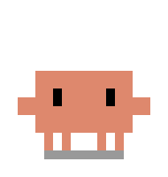
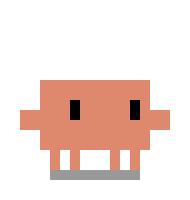
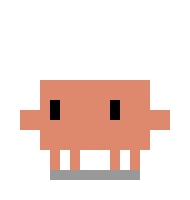
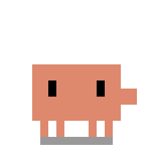
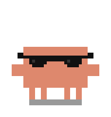
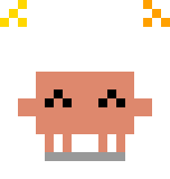
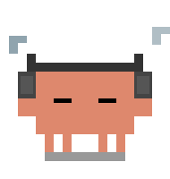
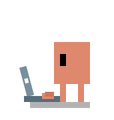
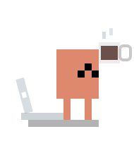
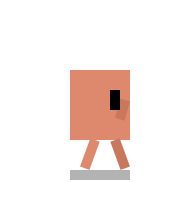
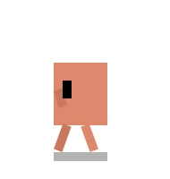
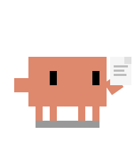
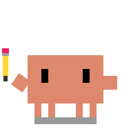
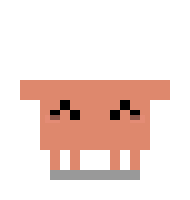
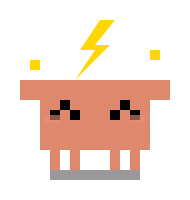
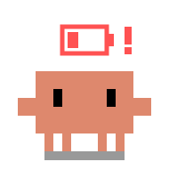
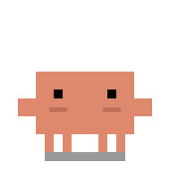

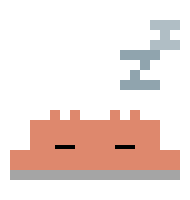
</p>

## What it does

Clawd perches in the bottom-right corner of your screen and watches. It
knows when you're working in Claude, whether your laptop is plugged in, and
what you copied or are listening to — then it types, walks around, sips
coffee, and naps accordingly.

**Modes**

- **action** — you're focused on a window running Claude Code. Clawd types
  along with an arm tap and takes coffee breaks.
- **awake** — a `claude` process is up but you're elsewhere. Clawd idles,
  looks around, scratches, occasionally walks.
- **asleep** — nothing running. Drowsy transition, then a nap.

**How it finds out** (all read in-process by the pet binary)

| Signal | Source |
|---|---|
| Claude running / focused | `/proc/<pid>/comm` scan + niri event stream or Hyprland socket focus tracking |
| Music | any MPRIS player over D-Bus |
| Battery & charging | UPower on the system bus |
| Clipboard (copy reaction) | compositor clipboard watcher (Wayland) or chord keys (X11) |
| Cursor position | `QueryPointer` on X11 · pointer hover on Wayland |

## Platform support

| Session | Status |
|---|---|
| **niri** | verified daily on the developer's machine (perch, typing, drag, walking, reactions) |
| KDE Plasma / Hyprland / sway | layer-shell is the standard overlay protocol — should work as-is; Hyprland focus parser implemented and unit-tested |
| X11 | implemented (ARGB window, XShape, chords, eye-follow); needs a live session report |
| GNOME | not targeted |

## Build & run

```bash
git clone https://github.com/adarsh-67r/clawd
cd clawd
cargo build --release

# run from the repo checkout — the pet loads its pixel art from ./media
./target/release/clawd
```

You'll need Rust and a compiler; on Arch that's `pacman -S rust base-devel`.

Or install the binary directly:

```bash
cargo install --git https://github.com/adarsh-67r/clawd
# the binary looks for media/ and clawd.config.json next to your cwd or in
# ~/.config/clawd/ — keep a checkout of this repo somewhere stable
```

Quit at any time with `pkill -x clawd` (SIGTERM).

## Configuration

`clawd.config.json` — resolved in the order `~/.config/clawd/`, then next to
the executable.

<details>
<summary>Key settings</summary>

Only two things are read from the config file — the poll cadences and the
pet command. Everything else (poses, walks, coffee breaks, reactions) runs
on the upstream timing baked into the binary.

| Key | Default | What it controls |
|-----|---------|-----------------|
| `poll.systemState` | ms | `2500` | How often to poll `/proc`, MPRIS, battery, focus |
| `poll.cursor` | ms | `33` | Frame rate (~30fps) |
| `poll.keypress` | ms | `80` | Keyboard-chord polling (X11 only) |
| `claudeCommand` | str | `xdg-terminal-exec claude` | What gets spawned when you pet it |

</details>

## How it's built

```
clawd (single binary, one process)
├── main.rs          — 33ms frame loop: sensors → pose engine → canvas → host
├── pet.rs           — pose state machine (upstream timing, timestamp-driven):
│    typing arm-tap frames, random walk with wall clamp,
│    eye-follow, reactions, art bob
├── gfx.rs           — PNG sheet decode + nearest-neighbour compose
├── host/            — per display server
│    ├── wl.rs       — Wayland: layer-shell overlay surface, shm buffers,
│    │                 margin-based drag and walking, pointer events
│    ├── x.rs        — X11: ARGB window, XShape input regions, XMoveWindow
│    └── mod.rs      — Host trait + open() factory (Wayland first, X11 after)
└── sensors/         — /proc scan · niri & Hyprland focus streams · MPRIS ·
                       UPower · clipboard watcher · X11 chords/cursor
```

No spawned processes for sensing — sockets, `procfs`, and D-Bus are read
directly by the binary; the only process it ever spawns is opening Claude
when you pet it.

## License

This repository's code is **MIT** — see [LICENSE](LICENSE).

The pet's artwork in [`media/`](media/) comes from
[upstream Clawd](https://github.com/devsw-prayas/clawd-walks-on-your-desktop)
and is reused here with the author's OK. If you reuse the artwork, please
check with them too.

## Credits

- Pet, artwork, and the original Windows pet: [**devsw-prayas/clawd-walks-on-your-desktop**](https://github.com/devsw-prayas/clawd-walks-on-your-desktop)
- Linux port & native renderer: **adarsh-67r**
